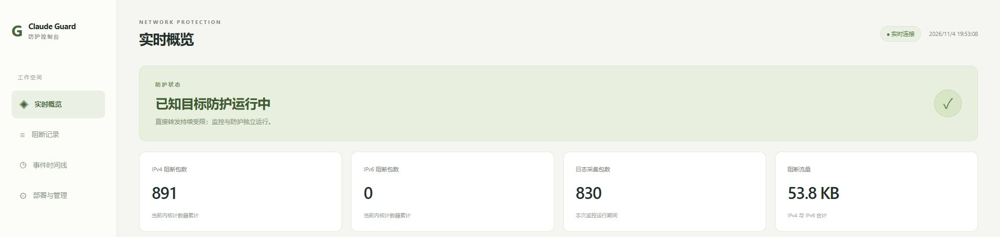
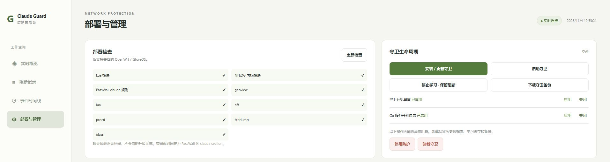

# Claude Guard Monitor

基于 Go、Lua、nftables、WebSocket 和 SQLite 的 PassWall 独立防直连守卫与管理控制台。

程序读取 PassWall 的 `claude` 分流规则，将静态 IP 和域名学习结果写入独立 nftables 集合，阻断发往这些目标的直接转发流量。Go 服务负责日志采集、状态统计、历史查询和守卫管理，不承担代理流量转发。

## 界面

实时概览：



部署与管理：



## 工作逻辑

```text
PassWall UCI claude 规则
        │
        ▼
Lua 守卫：读取规则、学习域名 IP、同步目标集合
        │
        ▼
nftables inet claude_guard
  targets4 / targets6
  forward_guard：限速日志 → counter → drop
        │
        ▼
Go：采集日志、读取计数、查询服务状态
        │
        ▼
SQLite → HTTP API / WebSocket → Web 控制台
```

### 规则与地址学习

`bundle/guard.lua` 读取 `/etc/config/passwall` 中的 `claude` section，要求其类型为 `shunt_rules`。规则支持域名表达式、geosite 展开、IPv4/IPv6 地址和 CIDR。节点信息从全局分流配置的 Claude 节点绑定中读取，用于状态展示。

守卫循环检查配置变化；配置解析失败时尝试使用已保存的策略。目标集合由静态 IP 与域名学习缓存合并生成，通过 nft 批处理更新。规则删除后，相应域名的学习缓存会被清理。

`bundle/observer.lua` 读取 tcpdump 的 PCAP 流，处理指定来源和端口的 UDP DNS 响应，以及客户端 TCP/443 上可见的 TLS ClientHello。`bundle/tls.lua` 处理 TCP 分段、重排与 TLS 记录，提取 SNI。守卫还通过配置的本地 DNS 服务分批查询种子域名。

### 独立阻断

防护表为 `inet claude_guard`，包含 IPv4 集合 `targets4`、IPv6 集合 `targets6` 和 `forward_guard` 链。链使用 forward hook，优先级 -10，匹配连接原始方向和目标地址，执行计数与 DROP。

日志规则位于 DROP 之前，日志限速不限制 DROP。停止监控服务不删除防护表；停止守卫学习也保留已有规则。停用或卸载守卫才会删除本组件的表。

保护对象是已知目标的直接转发流量，不包含路由器本机 OUTPUT。DNS 与 SNI 采用被动学习，首次出现的未知 IP 可能尚未进入集合；不解析 ECH 内层域名和 QUIC。节点状态用于展示，程序不强制绑定代理核心内部出口。

### 日志采集

配置字段 `log_backend` 控制采集后端：

| 值 | 实现 |
| --- | --- |
| 省略 / `auto` | 已加载 `nfnetlink_log` 时使用 NFLOG，否则使用 syslog |
| `nflog` | 默认 group 10631，每地址族限速 30 包/秒，突发 100 包 |
| `syslog` | 读取 `logread -f`，每地址族限速 5 包/秒，突发 10 包 |

syslog 子进程使用 UTC，按日志服务时间入库，精度为秒，并过滤采集启动秒之前的记录。日志提取来源/目标 IP、端口、协议、包长和时间。域名字段来自学习缓存中的候选映射。

内核计数与详细事件分别采集。限速、采集停机、队列溢出或写入失败会使详细事件数少于内核阻断包数。

### Web 与存储

- HTTPS 登录；初始化生成随机管理员密码。
- 管理网段检查、登录限速、会话 Cookie、CSRF 与 Origin 校验。
- 页面默认部分隐藏 IP 和 SSH 端口；显示开关全站同步，并在当前浏览器保存偏好。IPv4 保留第一段，IPv6 保留第一组，SSH 端口显示为星号。编辑框保留真实参数，隐藏时只读；终端按原字符数量遮盖地址，保留颜色、字体样式和列对齐，仍可输入命令、复制、粘贴及滚动查看最近 3,000 行历史。
- WebSocket 每秒推送状态和最近 6 条记录。
- 阻断记录与时间线使用服务端时间过滤和游标分页，每页最多 50 条。
- SQLite WAL 存储；CSV 导出按查询条件限制为最多 10,000 条。
- 详细事件保留 7 天、最多 150,000 行；统计保留上限 30 天、最多 180,000 行；时间线最多 10,000 行。
- 数据库默认 100 MiB 软阈值，达到阈值后暂停详细事件写入。

### 节点测速

列表显示节点的服务器域名或 IP，支持主机搜索和分组内排序：默认按节点名称，可切换为按协议（再按传输方式）或按主机；同类再按节点名称自然排序。主机使用 PassWall 中配置的地址，不额外解析 DNS。单节点测速按钮在任务运行时变为“停止”，停止当前任务及其剩余队列。

批量测速在启动时按列表相同的分组与排序规则排列所选节点，不按勾选先后排列。筛选隐藏的已选节点仍参与批量任务；任务启动后改变列表排序不会重排正在运行的队列。

“代理测试”读取 PassWall UCI 节点列表及 `group` 分组，支持分组筛选、折叠、整组选择、组内测速，以及单个或勾选批量下载、上传、双向测速。分组按钮作用于当前筛选结果中的可测节点。任务逐节点运行，每个节点先下载再上传，可随时停止。进度通过 WebSocket 推送，SQLite 保存结果；节点列表展示保留期内每个方向最近一次测速结果及时间，桌面端下载目标、上传目标、方向、横向平铺的分组（含“全部”）、搜索、排序和测速操作统一随工具栏吸顶，表头紧随其后。代理测速历史通过左侧“测速历史”独立查看，支持节点与时间范围筛选、游标分页，每页 50 组，同轮同节点的下载与上传合并一行，保留期限沿用 `stats_days`，最多 10,000 行。

各页面使用独立路径（如 `/speed`、`/speed-history`、`/ssh`）；刷新或登录后保留当前页面，支持浏览器前进、后退和收藏。

测速调用路由器已有的 PassWall Lua 出站生成器，读取普通 Xray / Sing-box 节点参数，在私有临时目录生成配置并启动独立核心。临时 SOCKS 入口仅监听回环地址并启用随机认证；HTTP 请求通过该 SOCKS 出口发送，目标域名交给代理核心处理。出站使用 PassWall 的 `255` 绕过标记。任务结束后清理进程与临时配置。分流、负载均衡、链式配置及不支持的核心会在列表显示原因。

默认使用 [Cloudflare Speedtest](https://github.com/cloudflare/speedtest) 的 `__down` 与 `__up` 接口。每方向默认 10 秒，下载最多 100 MiB、上传最多 50 MiB；速度以有效字节数除以包含连接和等待的耗时计算。Cloudflare 下载分为最多 8 MiB 的请求；公共目标上传使用递增至 4 MiB 的 POST 请求，仅计入成功响应的数据；时限内未确认的上传不计入有效传输。下载达到时限时保留已接收样本。结果是软路由经该节点到目标的单连接吞吐，受本地线路、代理核心、节点和目标接入地区共同影响。

公共目标还包括 [Hetzner 美国 Ashburn](https://ash-speed.hetzner.com/)、[德国 Falkenstein](https://fsn1-speed.hetzner.com/) 和 [OVHcloud](https://proof.ovh.net/) 法国 Roubaix、新加坡、美国 Hillsboro 的测速接口。Hetzner 支持下载，OVHcloud 支持下载与上传。下载和上传目标可独立选择；上传列表仅显示支持上传的目标。公共目标可能限速、变更或暂时不可用，HTTP 错误记录为测速失败。

测速设置独立保存在配置目录的 `speedtest.json`。自定义目标支持 HTTPS 下载地址、上传地址与 PUT / POST；可填入 OSS 预签名 URL。下载按设置上限读取，上传发送指定大小的 `application/octet-stream` 请求体。PUT 应使用专用测速对象，批量任务会重复写入同一对象。历史仅保存目标主机名，预签名查询参数保存在权限为 `0600` 的设置文件中。

### SSH 管理与直连测试

“SSH 管理”提供独立的主机列表，支持按名称、IP、端口、用户名搜索及凭据状态筛选。可维护名称、IPv4 / IPv6 地址、SSH 端口、用户名，以及密码或 OpenSSH / PEM 私钥；加密私钥可填写口令。主机可先保存连接信息，稍后补充凭据；列表显示“待补密码”或“待补私钥”，补充后可检查连接、安装 iperf3、打开远程终端或测速。凭据保存在配置目录的 `ssh-hosts.json`（`0600`），列表接口不返回凭据，编辑时留空保留已保存的凭据。可以预填 SHA256 主机指纹；留空时在首次成功认证后保存指纹，以后连接校验该指纹。

主机通过弹窗新增和编辑；“测试连接”使用表单当前地址、端口、用户名和凭据验证 SSH 登录，凭据留空时复用该主机已保存的同类凭据。测试不保存表单或修改主机指纹。

SSH 管理页通过弹窗提供连接检查、iperf3 安装、测速、进度、历史和终端。关闭测试窗口后任务继续，可从列表重新查看或停止。两台远程主机互测时，源主机运行 iperf3 客户端，目标主机运行临时服务；测试流量在远端之间传输，软路由仅负责 SSH 控制与读取结果。支持 TCP / UDP、指定端口和双向依次测试，历史按源、目标主机均可查询，同轮同协议的下载与上传合并一行并整组分页。远程终端使用 xterm.js 6.0.0、FitAddon 0.11.0（MIT，资源随程序内置），支持交互 Shell、尺寸调整、Ctrl+V 粘贴；Ctrl+C 在选中文字时复制，否则中断命令；关闭终端或退出登录会断开远端会话。

测速链路为软路由直连所选主机，下载指远端到软路由，上传指软路由到远端。提供以下方式：

| 方式 | 测量与依赖 |
| --- | --- |
| 原生 SSH | 通过 SSH 加密连接传输内存数据；远端需要 `head`、`wc` 和 `/dev/zero`。每方向 3–60 秒，流量上限沿用测速设置。上传按远端最终确认的接收字节计量；吞吐受 SSH 加密和 CPU 性能影响。 |
| iperf3 TCP / UDP | 指定测速端口（1–65535，低于 1024 可能需要远端 root 权限）、每方向时长（3–60 秒），可依次测试 TCP 与 UDP、下载与上传。UDP 目标速率为 1–10000 Mbps，结果包含接收速率、丢包率和抖动。流量按时长及实际速率产生。 |

测试窗口默认选择 iperf3，每方向 20 秒。高级设置支持 TCP 并发连接数（1–8）、TCP 总限速（0 表示不限速，按连接数均分）、预热时间（0–10 秒，默认 2 秒）和 UDP 数据包长度（64–65507 字节，默认 1200）。预热额外耗时，不计入正式采样和平均值。历史保存测试参数、发送端及接收端平均速度、UDP 丢包与抖动，以及版本提供的有效 TCP 重传、远程主机互测 RTT。软路由回环转发器上的 RTT 不代表远程链路，不予展示。

本页运行过的 iperf3 每秒采样可通过“本页采样”或“查看每秒采样”打开曲线与明细；刷新、关闭页面或退出登录后清空，采样不写入历史数据库。互测结果以源主机为参照，分别标注源主机下载、上传及实际主机流向。

“检查连接”验证 SSH 登录并检查两端 iperf3。“安装 iperf3”通过 SSH 在远端安装缺失的软件包，并在软路由安装本地客户端，支持 opkg、apk、apt-get、dnf 和 yum，需要 root 或免密 sudo 及可访问的软件源。已有 iperf3 时复用现有版本。远端测速服务按次临时启动，任务结束或停止时关闭，异常断开时由限时清理机制终止。UDP 测试还需要同端口 TCP 控制连接，服务器防火墙与云安全组需放通对应端口的 TCP / UDP。

SSH 出站设置 PassWall 绕过标记 `255`。iperf3 通过本地回环 TCP / UDP 转发器连接远端，转发器出站同样设置该标记，确保不经代理节点；本地转发及软路由 CPU 也可能影响测速上限。任务复用现有进度、停止按钮和历史记录，与代理节点测速互斥。iperf3 每秒更新客户端的发送或接收速度，完成后显示接收端平均速度、UDP 丢包与抖动。下载、上传使用蓝色和橙色区分，同一主机与协议的双向结果并排展示。

测速停止时保存已取得的字节数、采样时长和平均速度，并保留“已停止”状态。代理上传按已确认的请求计量；原生 SSH 或 iperf3 上传尚未获得接收端汇总时，显示发送端统计及未确认提示。iperf3 中断结果同时保留可用的丢包、末次抖动和重传统计。未开始的方向以历史有效结果补位，明确标记日期；SSH 历史按源主机、目标主机、方式、协议和测速端口匹配，补位仅用于显示。

## 代码结构

| 路径 | 职责 |
| --- | --- |
| `main.go` | 配置、证书、初始化与服务入口 |
| `server.go` | HTTP API、会话、CSRF、WebSocket |
| `poll.go` | 防火墙计数、进程状态与日志规则维护 |
| `collector_linux.go` | NFLOG 采集 |
| `collector_syslog_linux.go` / `log_backend.go` | syslog 采集、解析及后端选择 |
| `packet.go` | IP 数据包头解析 |
| `store.go` | SQLite、分页查询、聚合与清理 |
| `lifecycle.go` | 守卫渲染、安装、备份、恢复与服务操作 |
| `speed.go` / `speed_api.go` | 测速任务、临时核心、传输测量、设置与历史 API |
| `ssh_hosts.go` / `ssh_terminal.go` / `ssh_speed.go` / `ssh_iperf.go` | SSH 主机维护、交互终端、原生 SSH 测速、iperf3 安装及点对点测速 |
| `bundle/speed.lua` | PassWall 节点读取与临时出站配置生成 |
| `bundle/` | Lua 守卫、PCAP 观察器、SNI 解析及 procd 脚本 |
| `web/` | HTML、CSS、JavaScript 控制台 |
| `deploy/` | 引导安装脚本与 Go procd 服务 |

## 构建

Go 版本要求见 `go.mod`。SQLite 使用纯 Go 驱动，构建时禁用 CGO。

```sh
go test ./...
mkdir -p dist
CGO_ENABLED=0 GOOS=linux GOARCH=amd64 GOAMD64=v1 go build -trimpath -o dist/claude-guard-monitor-linux-amd64 .
```

PowerShell：

```powershell
.\build.ps1
.\build.ps1 -GoExecutable 'C:\path\to\go.exe'
.\build.ps1 -TestOnly
```

脚本运行测试并生成 Windows 与 Linux amd64 二进制。Go 可从 PATH 获取，也可通过参数指定。

## 部署

目标环境：Linux x86_64、OpenWrt 系列、procd、持久 `/overlay`，以及以下依赖：

- Lua 5.1：`uci`、`nixio`、`nixio.fs`、`luci.jsonc`。
- `nft`、`tcpdump`、`ubus`。
- geosite 规则需要 `geoview` 及对应数据文件。
- NFLOG 需要匹配固件内核的 `nfnetlink_log`；syslog 需要 `nft_log`、内核日志支持与 `logread`。

将 Linux 二进制与 `deploy/` 下两个文件放到同一目录，以 root 执行：

```sh
sh install.sh 192.168.10.1:9088 127.0.0.1/32,::1/128,192.168.10.0/24
```

地址和网段按目标设备填写。引导脚本安装 Go 服务、生成配置和随机密码、启用开机自启；不立即安装守卫。

登录凭据位于 `/etc/claude-guard-monitor/credentials.txt`。登录 HTTPS 控制台后，在“部署与管理”设置 DNS、可信来源、客户端网段与路由器 IP，保存参数，再执行“安装 / 更新守卫”。默认 TLS 证书由程序自签，也可替换配置目录中的证书与私钥。

## 配置与维护

| 路径 | 内容 |
| --- | --- |
| `/etc/claude-guard-monitor/config.json` | 监听地址、管理网段、密码哈希、日志后端、存储策略、守卫参数 |
| `/etc/claude-guard-monitor/speedtest.json` | 测速目标、传输时限、流量上限与自定义 URL |
| `/etc/claude-guard-monitor/ssh-hosts.json` | SSH 主机、登录凭据与主机指纹 |
| `/etc/claude-guard-monitor/server.crt` / `server.key` | TLS 证书与私钥 |
| `/overlay/claude-guard-monitor/monitor.db` | SQLite 数据库 |
| `/overlay/claude-guard-monitor/backup-*.zip` | 守卫安装/卸载备份 |
| `/usr/libexec/claude-guard/` | 守卫脚本 |
| `/etc/claude-guard/` | 策略与学习缓存 |

网页支持安装/更新、启动、停止学习、停用、卸载，以及守卫和 Go 服务的独立自启开关。安装前检查脚本与策略，备份已有文件；失败时尝试恢复旧脚本。

```sh
/etc/init.d/claude-guard status
/etc/init.d/claude-guard-monitor status
nft list chain inet claude_guard forward_guard
lua /usr/libexec/claude-guard/cli.lua status
```

升级二进制时先上传临时文件并校验，再停止 Go、替换、启动；保留配置、证书、密码和数据库。备份 SQLite 时停止 Go，并复制包含 WAL 的整个数据目录。

## 测试

Go 测试覆盖包头与日志解析、内核计数、SQLite、鉴权、分页、WebSocket 和参数渲染。目标机 Lua 测试：

```sh
lua /usr/libexec/claude-guard/test.lua
lua /usr/libexec/claude-guard/test-sni.lua
```

真实 WebSocket 测试默认跳过。设置 `CG_LIVE_TEST=1` 后，以 `CG_LIVE_URL`、`CG_LIVE_CA`、`CG_LIVE_CREDENTIALS` 和可选 `CG_LIVE_TLS_NAME` 指定测试目标及本地凭据。
